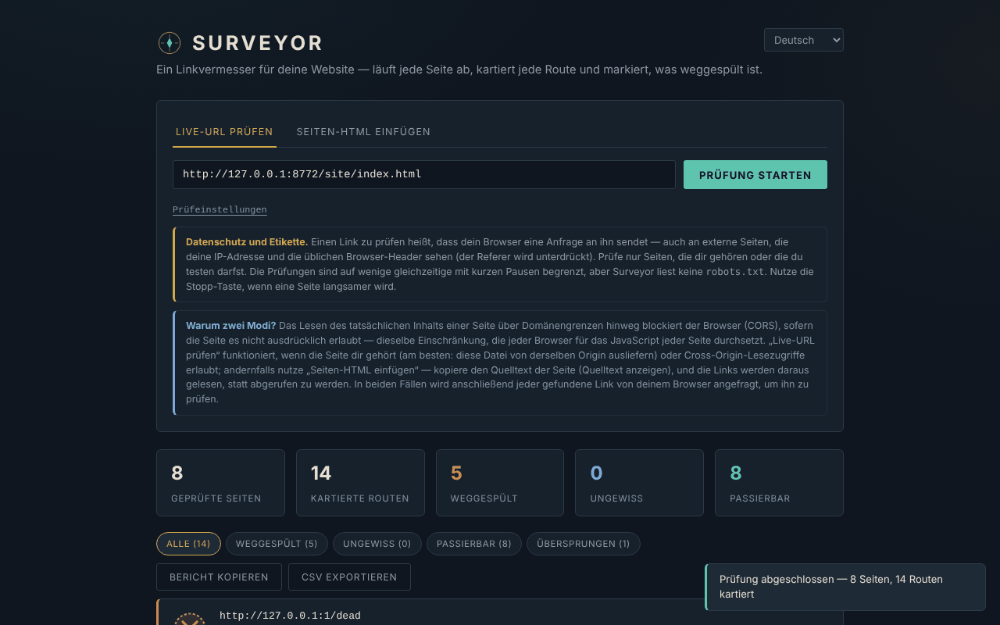

# Surveyor

[English](README.md) · [Română](README.ro.md) · [Français](README.fr.md) · [Italiano](README.it.md) · [Español](README.es.md) · [Português](README.pt.md) · **Deutsch** · [Magyar](README.hu.md)

**Version:** 2.1.0 · **Zuletzt aktualisiert:** 2026-10-27

Oberflächensprachen: **Română, English, Français, Italiano, Español, Português (PT), Deutsch, Magyar**

Link-Prüfer für Websites, in einer einzigen HTML-Datei. Die Oberfläche hat **8 Sprachen** (RO, EN, FR, IT, ES, PT, DE, HU); die Dokumentation (diese Datei) ist auf Deutsch.

**Online:** https://chiuta.github.io/Surveyor/

## Was es ist

Surveyor nimmt eine Startseite, liest die `<a href>`-Links (und optional die ``-Bilder), durchläuft die Seiten desselben Ursprungs und prüft, ob jede Adresse antwortet. Die Ergebnisse lassen sich filtern, als Textbericht kopieren oder als CSV exportieren. Es hat keinen Server, keine Analytics, keine Cookies und speichert zwischen Besuchen nichts.

**Wichtig:** Es ist kein „rein lokales“ Werkzeug. Um einen Link zu prüfen, sendet dein Browser eine Anfrage an diesen Link, auch an externe Websites (siehe „Datenschutz und Netzwerk“).

## Funktionen

Im Code und in einem Headless-Browser (Chromium/Playwright) auf einer lokalen Testseite überprüft:

- Zwei Modi: **Survey a live URL** (lädt die Startseite und die Seiten desselben Ursprungs herunter) und **Paste page HTML** (liest die Links aus dem eingefügten HTML, mit optionaler Basis-URL für relative Links; beachtet `<base href>`).
- Einstellungen: maximale Seitenzahl (1–200, Standard 25), Tiefe (1–10, Standard 3), Prüfung der Bilder. Nur Seiten desselben Ursprungs werden durchlaufen; externe Links werden nur geprüft, nie durchlaufen.
- Vier Zustände: **Passable**, **Washed out**, **Uncertain**, **Skipped** (siehe „Grenzen“). Filter nach Zustand, Liste der Seiten, die den jeweiligen Link enthalten.
- Anfragen mit Zeitlimit (9 s für Prüfungen, 15 s für eine Seite); bei 400/403/405/501 auf `HEAD` wird mit `GET` wiederholt.
- Schaltfläche **Stop**: bricht alle laufenden Anfragen ab; was nicht geprüft wurde, erscheint als „skipped / stopped“.
- Grenzen: höchstens 4 parallele Prüfungen, mit 250 ms Pause zwischen den Stapeln; höchstens 3000 verschiedene Adressen pro Durchlauf; angezeigt werden die ersten 500 Zeilen (die CSV enthält alles).
- **Copy report** (Text) und **Export CSV**. In der CSV wird Zellen, die mit `=`, `+`, `-`, `@`, TAB oder CR beginnen, ein Apostroph vorangestellt (verhindert die Ausführung von Formeln in Excel/Calc); die Datei hat ein UTF-8-BOM.
- Links mit `javascript:`, `data:`, `mailto:` usw. erscheinen als Text, nicht als anklickbare Links.
- Anker innerhalb der Seite (`#abschnitt`) werden lokal gegen die Attribute `id`/`name` des gelesenen oder eingefügten HTML geprüft — die einzige Art „defekter Link“, die sich auch im Modus Paste / `file://` zuverlässig erkennen lässt.
- Helles Design auf Wunsch (Systemeinstellung) und Druckstil.
- Barrierefreiheit: Tabs mit Pfeiltasten/Pos1/Ende, `aria-selected`, Fortschrittsbalken mit `role="progressbar"`, sichtbarer Fokus.

## Bedienungsanleitung

1. Öffne die Seite (oder `index.html` lokal).
2. **Survey a live URL**: Gib die Adresse `http(s)://…` deiner Website ein und drücke **Start survey**. Am zuverlässigsten ist es, wenn Surveyor vom **gleichen Ursprung** wie die geprüfte Website ausgeliefert wird; andernfalls muss die Website CORS-Header (`Access-Control-Allow-Origin`) senden, auch bei Fehlerantworten. Wenn die Startseite nicht gelesen werden kann, siehst du eine Meldung.
3. **Paste page HTML**: Füge den Seitenquelltext ein (Quelltext anzeigen), trage optional die Basis-URL ein und drücke **Check these links**.
4. Verfolge den Fortschritt; **Stop** unterbricht den Durchlauf.
5. Filtere nach Zustand und öffne „Referenced on N pages“, um zu sehen, wo der Link korrigiert werden muss.
6. **Copy report** kopiert eine Zusammenfassung der „washed out“-Links; **Export CSV** lädt alle Ergebnisse herunter.

## Datenschutz und Netzwerk

- **Speicherung:** keine. Es verwendet weder `localStorage`, `sessionStorage`, IndexedDB noch Cookies.
- **Von der Seite geladene externe Hosts:** keine (keine CDNs, Schriftarten oder externen Skripte). Die CSP-Richtlinie im `<meta>`-Tag erlaubt das Skript nur per Hash sowie `http(s)`-Verbindungen.
- **Was dennoch gesendet wird:** Für jede geprüfte Adresse sendet dein Browser eine `HEAD`-Anfrage (manchmal `GET`) an den Host dieser Adresse. Das schließt **externe Websites** ein: Sie sehen deine IP-Adresse und die üblichen Browser-Header (User-Agent). Die Anfragen werden mit `referrerPolicy: no-referrer` (ohne Referer-Header) und an Dritte ohne Cookies gestellt. Anfragen an die geprüfte Website können den Header `Origin` mit dem Ursprung der Seite enthalten, auf der Surveyor gehostet wird. Im Modus „live URL“ werden die durchlaufenen Seiten vollständig heruntergeladen.
- **Was NICHT geschieht:** kein Aufruf beim Autor oder bei einem Server der Anwendung; die Berichte (Copy/CSV) bleiben in deinem Browser, bis du sie selbst speicherst oder einfügst.
- **HTML von Dritten:** Heruntergeladene oder eingefügte Seiten werden mit `DOMParser` geparst (inertes Dokument: keine Skripte ausgeführt, keine Unterressourcen geladen). Die in den Ergebnissen angezeigten Adressen werden maskiert, und nur die `http(s)`-Adressen werden zu Links (`rel="noopener noreferrer"`).

### Ethik und Höflichkeit

Prüfe nur eigene Websites oder solche, für die du eine Erlaubnis hast. Surveyor **liest `robots.txt` nicht** und begrenzt die Anfragen pro Host nicht über die 4 parallelen mit Pausen hinaus; es ist nicht dafür gedacht, fremde Websites zu durchlaufen. Beende den Durchlauf, wenn ein Server langsamer wird. Beachte die Bedingungen der geprüften Websites.

## Grenzen und Warnhinweise

- **Externe Links lassen sich nicht bestätigen.** Der Browser verbirgt den HTTP-Status von Cross-Origin-Antworten (CORS): Ein externer Link, der antwortet, selbst mit einem 404, erscheint als **Uncertain**. Surveyor findet nur unerreichbare Hosts (DNS, Verbindung verweigert, Zeitüberschreitung), keine toten Seiten auf fremden Websites. Es mag verlockend sein, „Passable“ = gut zu lesen; für externe Links erscheint dieser Zustand nie.
- **„Washed out“ bei externen Links kann ein Fehlalarm sein:** Erweiterungen/Werbeblocker, VPN, Firewall, gemischte Inhalte (Prüfung einer `http://`-Website von einer `https://`-Seite aus) sehen genauso aus wie „unreachable“. Prüfe erneut, bevor du Seiten änderst.
- Ist das CORS-Lesen für einen Link mit „internem“ Ursprung blockiert, sinkt das Ergebnis auf „Uncertain“ (nicht „Washed out“), wenn der Host dennoch antwortet.
- Es liest nur statisches HTML: JavaScript-generierte Links (SPA), `srcset`, `<link>`, Skripte, CSS-Stile, iframes und `data-src`-Attribute werden nicht erfasst. `www.beispiel.de` und `beispiel.de` sind verschiedene Ursprünge (der zweite wird als extern behandelt).
- Seiten über 5 MB (laut `Content-Length`) werden nicht durchlaufen; Grenzen: 200 Seiten, 3000 Adressen.
- Die Ergebnisse sind eine Momentaufnahme; eine Website, die langsam oder mit Ratenbegrenzung antwortet, kann „timed out“ erzeugen.
- Persönliches Projekt, „wie besehen“ angeboten, ohne Gewährleistung.

## Lokal / offline ausführen

Lade `index.html` herunter und öffne sie im Browser. Die Seite startet ohne Internet, aber die Linkprüfung benötigt ein Netzwerk. Von `file://` aus funktioniert der Modus „live URL“ nur mit Websites, die CORS erlauben.

## Lizenz

MIT — siehe Datei `LICENSE`. Angegeben im Kopfbereich der Datei `index.html` und in der Fußzeile der Seite.

## Verlauf / Changelog

### 1.2.4 — 2026-10-22

fff-kit 1.1.4: Touch-Ziele und Mindestschriftgröße.

### 1.2.3 — 2026-10-22
- fff-kit 1.1.2: PBKDF2 mit 600.000 Iterationen, Schutz vor Clickjacking

### 1.2.2 — 2026-10-22
- Mobil: kein Text unter 12 px und Touch-Ziele von mindestens 24 px (WCAG 2.5.8).

### 1.2.1 — 2026-10-22
- Übersetzungskorrekturen: Seitentitel und Meta-Tags folgen jetzt der Oberflächensprache; Textreste in der falschen Sprache entfernt.

- 1.1.0 — 2026-10-14: Datensicherung und Datenkennzeichnung (fff-kit).

- 1.0.0 — 2026-10-12: Die Version und das Datum der letzten Aktualisierung werden in der Anwendung angezeigt (erste nummerierte Version).

Runde 7:
- **Zähler „Pages surveyed“ korrigiert:** Er zählte jede Seitenanfrage (einschließlich 404, Weiterleitungen und Aliasse wie `/b` → `/b/`); jetzt zählt er nur tatsächlich gelesene Seiten, einmal pro endgültiger URL (auf einer Testseite mit 3 Seiten, 1 defektem Link und 2 Weiterleitungen zeigte er 6; jetzt 3). Das Limit „max pages“ bleibt auf die Anzahl der Anfragen bezogen.
- **Erläuternder Hinweis, wenn Ergebnisse „unreadable“ sind:** Wird Surveyor von `file://` aus geöffnet (oder lassen sich Links desselben Ursprungs wegen CORS nicht lesen), erscheint unter der Zusammenfassung ein Hinweis, dass diese Links „Uncertain“ und nicht defekt sind, und wie man echte Status erhält (von der geprüften Website / `http://localhost` ausliefern).
- **Sichtbare Weiterleitungen:** Links, die nach einer Weiterleitung antworten, zeigen „HTTP 200 · redirects to …“ (auch in der CSV / im Copy report).
- Der CSP-Hash des Skripts wurde neu berechnet. axe-core: 0 Verstöße bei 1280 und 360 px.
- **Anker innerhalb der Seite geprüft:** `#abschnitt`-Links werden mit den Attributen `id`/`name` der gelesenen Seite verglichen (Modi Paste und live); ein fehlender Anker erscheint als „Washed out“, Typ „anchor“. `#` und `#top` sind stets gültig; im Live-Modus wird auch `andere-seite#teil` geprüft, wenn diese Seite gelesen wurde. JavaScript-generierte Anker werden nicht erfasst. `#…`-Links ohne Basis-URL erscheinen nicht mehr als „unparseable“.
- Automatisches helles Design (`prefers-color-scheme: light`; das dunkle bleibt Standard) und Druckstil (es wird nur die Ergebnisliste gedruckt).
- Der CSP-Hash des Skripts wurde neu berechnet. axe-core: 0 Verstöße bei 1280 und 360 px, in beiden Designs.

Runde 5:
- Links nur mit Fragment (`#top`, `seite#abschnitt` auf dieselbe Seite) werden nicht mehr als Routen gezählt (und in Runde 6 als Anker geprüft); Varianten derselben URL mit unterschiedlichem Fragment werden zu einer einzigen Route zusammengeführt.
- Links mit demselben Ursprung wie die geprüfte Website, deren Antworten sich von der aktuellen Seite aus aber nicht lesen lassen (Modus Paste oder `file://`, ohne CORS), erscheinen jetzt als „Uncertain — same site, status unreadable from this page (CORS/file://)“, nicht als „cross-origin“. Die Grenze bleibt: Ein 404 lässt sich ohne CORS oder ohne Auslieferung von Surveyor vom selben Ursprung nicht erkennen.
- Der CSP-Hash des Skripts wurde neu berechnet. axe-core: 0 Verstöße bei 1280 und 360 px.

## Autor

Alexio — Alexandru-Ionuț Chiuță, Kontakt: alexio@trom.tf
