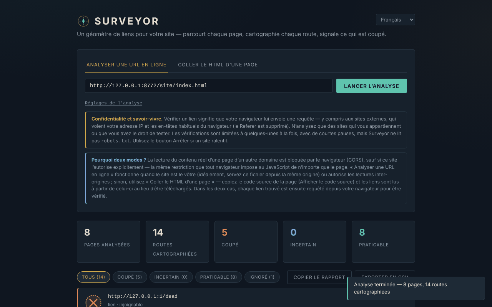

# Surveyor

[English](README.md) · [Română](README.ro.md) · **Français** · [Italiano](README.it.md) · [Español](README.es.md) · [Português](README.pt.md) · [Deutsch](README.de.md) · [Magyar](README.hu.md)

**Version :** 1.2.5 · **Dernière mise à jour :** 2026-10-23

Langues de l'interface : **Română, English, Français, Italiano, Español, Português (PT), Deutsch, Magyar**

Vérificateur de liens pour sites web, dans un seul fichier HTML. L'interface compte **8 langues** (RO, EN, FR, IT, ES, PT, DE, HU) ; la documentation (ce fichier) est en français.

**En ligne :** https://chiuta.github.io/Surveyor/

## Qu'est-ce que c'est

Surveyor prend une page de départ, lit les liens `<a href>` (et, facultativement, les images ``), parcourt les pages de la même origine et vérifie si chaque adresse répond. Les résultats peuvent être filtrés, copiés sous forme de rapport texte ou exportés en CSV. Il n'a ni serveur, ni analytique, ni cookies, et ne sauvegarde rien entre les visites.

**Important :** ce n'est pas un outil « local uniquement ». Pour vérifier un lien, votre navigateur envoie une requête vers ce lien, y compris vers des sites externes (voir « Confidentialité et réseau »).

## Fonctions

Vérifiées dans le code et dans un navigateur headless (Chromium/Playwright) sur un site de test local :

- Deux modes : **Survey a live URL** (télécharge la page de départ et les pages de la même origine) et **Paste page HTML** (lit les liens du HTML collé, avec une URL de base facultative pour les liens relatifs ; respecte `<base href>`).
- Réglages : nombre maximal de pages (1–200, 25 par défaut), profondeur (1–10, 3 par défaut), vérification des images. Seules les pages de la même origine sont parcourues ; les liens externes sont uniquement vérifiés, jamais parcourus.
- Quatre états : **Passable**, **Washed out**, **Uncertain**, **Skipped** (voir « Limites »). Filtres par état, liste des pages contenant chaque lien.
- Requêtes avec délai d'expiration (9 s pour les vérifications, 15 s pour une page) ; sur 400/403/405/501 en `HEAD`, nouvelle tentative en `GET`.
- Bouton **Stop** : interrompt toutes les requêtes en cours ; ce qui n'a pas été vérifié apparaît comme « skipped / stopped ».
- Limites : au plus 4 vérifications en parallèle, avec une pause de 250 ms entre les lots ; au maximum 3000 adresses distinctes par exécution ; les 500 premières lignes sont affichées (le CSV contient tout).
- **Copy report** (texte) et **Export CSV**. Dans le CSV, les cellules qui commencent par `=`, `+`, `-`, `@`, TAB ou CR sont préfixées d'une apostrophe (cela empêche l'exécution de formules dans Excel/Calc) ; le fichier comporte un BOM UTF-8.
- Les liens `javascript:`, `data:`, `mailto:`, etc. apparaissent sous forme de texte, et non comme des liens cliquables.
- Les ancres internes (`#section`) sont vérifiées localement par rapport aux attributs `id`/`name` du HTML lu ou collé — le seul type de « lien rompu » détectable de façon fiable également en mode Paste / `file://`.
- Thème clair à la demande (préférence du système) et style d'impression.
- Accessibilité : onglets avec flèches/Début/Fin, `aria-selected`, barre de progression avec `role="progressbar"`, focus visible.

## Mode d'emploi

1. Ouvrez la page (ou `index.html` en local).
2. **Survey a live URL** : saisissez l'adresse `http(s)://…` de votre site et appuyez sur **Start survey**. Le plus fiable est que Surveyor soit servi depuis la **même origine** que le site vérifié ; sinon le site doit envoyer des en-têtes CORS (`Access-Control-Allow-Origin`), y compris sur les réponses d'erreur. Si la page de départ ne peut pas être lue, un message s'affiche.
3. **Paste page HTML** : collez le source de la page (Afficher le code source), renseignez éventuellement l'URL de base et appuyez sur **Check these links**.
4. Suivez la progression ; **Stop** interrompt l'exécution.
5. Filtrez par état et ouvrez « Referenced on N pages » pour voir où le lien doit être corrigé.
6. **Copy report** copie un résumé des liens « washed out » ; **Export CSV** télécharge tous les résultats.

## Confidentialité et réseau

- **Stockage :** aucun. Il n'utilise ni `localStorage`, ni `sessionStorage`, ni IndexedDB, ni cookies.
- **Hôtes externes chargés par la page :** aucun (ni CDN, ni polices, ni scripts externes). La politique CSP de la balise `<meta>` n'autorise le script que par hachage et les connexions `http(s)`.
- **Ce qu'il envoie malgré tout :** pour chaque adresse vérifiée, votre navigateur envoie une requête `HEAD` (parfois `GET`) à l'hôte de cette adresse. Cela inclut les **sites externes** : ils voient votre adresse IP et les en-têtes habituels du navigateur (User-Agent). Les requêtes sont faites avec `referrerPolicy: no-referrer` (sans en-tête Referer) et, vers des tiers, sans cookies. Les requêtes vers le site vérifié peuvent inclure l'en-tête `Origin` avec l'origine de la page où Surveyor est hébergé. En mode « live URL », les pages parcourues sont téléchargées intégralement.
- **Ce qui ne se produit PAS :** aucun appel à l'auteur ni à un serveur de l'application ; les rapports (Copy/CSV) restent dans votre navigateur jusqu'à ce que vous les enregistriez ou les colliez vous-même.
- **HTML reçu de tiers :** les pages téléchargées ou collées sont analysées avec `DOMParser` (document inerte : aucun script exécuté, aucune sous-ressource chargée). Les adresses affichées dans les résultats sont échappées, et seules celles en `http(s)` deviennent des liens (`rel="noopener noreferrer"`).

### Éthique et courtoisie

Ne vérifiez que vos propres sites ou ceux pour lesquels vous avez une autorisation. Surveyor **ne lit pas `robots.txt`** et ne limite pas les requêtes par hôte au-delà des 4 parallèles avec pauses ; il n'est pas conçu pour parcourir des sites tiers. Arrêtez l'exécution si un serveur ralentit. Respectez les conditions des sites vérifiés.

## Limites et avertissements

- **Les liens externes ne peuvent pas être confirmés.** Le navigateur masque le statut HTTP des réponses cross-origin (CORS) : un lien externe qui répond, même par un 404, apparaît comme **Uncertain**. Surveyor ne repère que les hôtes injoignables (DNS, connexion refusée, délai dépassé), pas les pages mortes sur des sites étrangers. Il peut être tentant de lire « Passable » = bon ; pour les liens externes, cet état n'apparaît jamais.
- **« Washed out » sur des liens externes peut être une fausse alerte :** extensions/bloqueurs de publicité, VPN, pare-feu, contenu mixte (vérification d'un site `http://` depuis une page `https://`) ressemblent à « unreachable ». Revérifiez avant de modifier des pages.
- Si la lecture CORS est bloquée pour un lien d'origine « interne », le résultat descend à « Uncertain » (et non « Washed out ») lorsque l'hôte répond tout de même.
- Il ne lit que du HTML statique : les liens générés par JavaScript (SPA), `srcset`, `<link>`, les scripts, les styles CSS, les iframes et les attributs `data-src` ne sont pas vus. `www.exemple.fr` et `exemple.fr` sont des origines différentes (la seconde est traitée comme externe).
- Les pages de plus de 5 Mo (d'après `Content-Length`) ne sont pas parcourues ; limites : 200 pages, 3000 adresses.
- Les résultats sont un instantané ; un site qui répond lentement ou avec limitation de débit peut produire « timed out ».
- Projet personnel, proposé « tel quel », sans garanties.

## Exécution locale / hors ligne

Téléchargez `index.html` et ouvrez-le dans le navigateur. La page démarre sans internet, mais la vérification des liens exige un réseau. Depuis `file://`, le mode « live URL » ne fonctionne qu'avec des sites qui autorisent CORS.

## Licence

MIT — voir le fichier `LICENSE`. Déclarée dans l'en-tête du fichier `index.html` et dans le pied de page.

## Historique / Changelog

### 1.2.4 — 2026-10-22

fff-kit 1.1.4 : cibles tactiles et taille de texte minimale.

### 1.2.3 — 2026-10-22
- fff-kit 1.1.2 : PBKDF2 à 600 000 itérations, protection anti-clickjacking

### 1.2.2 — 2026-10-22
- Mobile : aucun texte sous 12 px et cibles tactiles d'au moins 24 px (WCAG 2.5.8).

### 1.2.1 — 2026-10-22
- Corrections de traduction : le titre de la page et les balises meta suivent la langue de l’interface ; textes restés dans la mauvaise langue supprimés.

- 1.1.0 — 2026-10-14 : sauvegarde et étiquetage des données (fff-kit).

- 1.0.0 — 2026-10-12 : la version et la date de dernière mise à jour sont affichées dans l'application (première version numérotée).

Tour 7 :
- **Compteur « Pages surveyed » corrigé :** il comptait chaque requête de page (y compris les 404, les redirections et les alias comme `/b` → `/b/`) ; il ne compte désormais que les pages réellement lues, une seule fois par URL finale (sur un site de test de 3 pages, 1 lien rompu et 2 redirections, il affichait 6 ; maintenant 3). La limite « max pages » reste portée sur le nombre de requêtes.
- **Note explicative lorsque les résultats sont « unreadable » :** si Surveyor est ouvert depuis `file://` (ou si les liens de même origine ne peuvent pas être lus à cause de CORS), une note apparaît sous le résumé, indiquant que ces liens sont « Uncertain », et non rompus, et comment obtenir de vrais statuts (le servir depuis le site vérifié / `http://localhost`).
- **Redirections visibles :** les liens qui répondent après une redirection affichent « HTTP 200 · redirects to … » (également dans le CSV / Copy report).
- Le hachage CSP du script a été recalculé. axe-core : 0 violation à 1280 et 360 px.
- **Ancres internes vérifiées :** les liens `#section` sont comparés aux attributs `id`/`name` de la page lue (modes Paste et live) ; une ancre manquante apparaît comme « Washed out », de type « anchor ». `#` et `#top` sont toujours valides ; en mode live, `autre-page#partie` est également vérifié si cette page a été lue. Les ancres générées par JavaScript ne sont pas vues. Les liens `#…` sans URL de base n'apparaissent plus comme « unparseable ».
- Thème clair automatique (`prefers-color-scheme: light` ; le thème sombre reste le thème par défaut) et style d'impression (seule la liste des résultats est imprimée).
- Le hachage CSP du script a été recalculé. axe-core : 0 violation à 1280 et 360 px, dans les deux thèmes.

Tour 5 :
- Les liens à fragment seul (`#top`, `page#section` vers la même page) ne sont plus comptés comme des routes (et au tour 6 ils sont vérifiés comme ancres) ; les variantes d'une même URL avec un fragment différent sont fusionnées en une seule route.
- Les liens de la même origine que le site vérifié, mais dont les réponses ne peuvent pas être lues depuis la page actuelle (mode Paste ou `file://`, sans CORS), apparaissent désormais comme « Uncertain — same site, status unreadable from this page (CORS/file://) » et non comme « cross-origin ». La limite demeure : un 404 ne peut pas être détecté sans CORS ou sans servir Surveyor depuis la même origine.
- Le hachage CSP du script a été recalculé. axe-core : 0 violation à 1280 et 360 px.

## Auteur

Alexio — Alexandru-Ionuț Chiuță, contact : alexio@trom.tf
