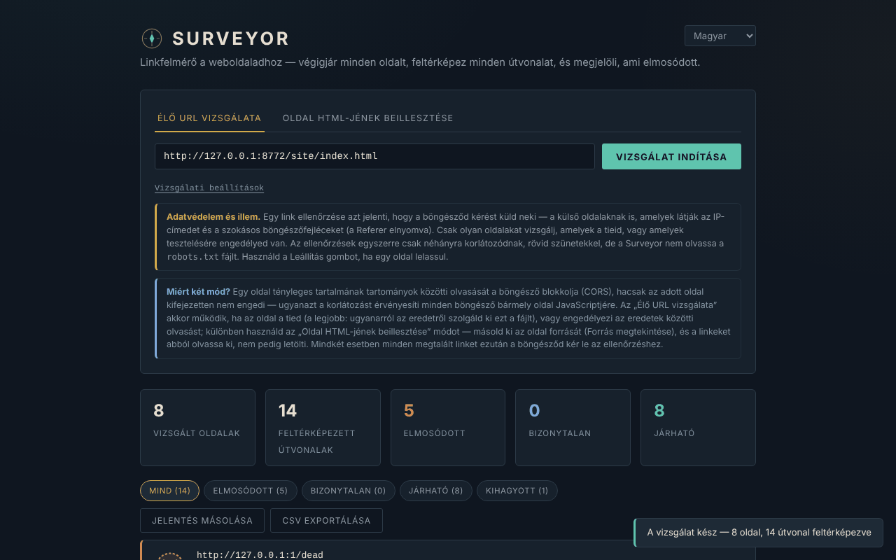

# Surveyor

[English](README.md) · [Română](README.ro.md) · [Français](README.fr.md) · [Italiano](README.it.md) · [Español](README.es.md) · [Português](README.pt.md) · [Deutsch](README.de.md) · **Magyar**

**Verzió:** 2.2.0 · **Utolsó frissítés:** 2026-10-27

A felület nyelvei: **Română, English, Français, Italiano, Español, Português (PT), Deutsch, Magyar**

Hivatkozásellenőrző weboldalakhoz, egyetlen HTML-fájlban. A felület **8 nyelvű** (RO, EN, FR, IT, ES, PT, DE, HU); a dokumentáció (ez a fájl) magyar nyelvű.

**Online:** https://chiuta.github.io/Surveyor/

## Mi ez

A Surveyor egy kezdőoldalt vesz, beolvassa az `<a href>` hivatkozásokat (és opcionálisan az `` képeket), bejárja az ugyanazon eredetű oldalakat, és ellenőrzi, hogy minden cím válaszol-e. Az eredmények szűrhetők, szöveges jelentésként másolhatók vagy CSV-ként exportálhatók. Nincs szervere, analitikája, sütije, és a látogatások között nem ment semmit.

**Fontos:** nem „kizárólag helyi” eszköz. Egy hivatkozás ellenőrzéséhez a böngésződ kérést küld az adott hivatkozásra, a külső oldalakat is beleértve (lásd „Adatvédelem és hálózat”).

## Funkciók

A kódban és egy headless böngészőben (Chromium/Playwright) egy helyi tesztoldalon ellenőrizve:

- Két mód: **Survey a live URL** (letölti a kezdőoldalt és az ugyanazon eredetű oldalakat) és **Paste page HTML** (a beillesztett HTML hivatkozásait olvassa be, relatív hivatkozásokhoz opcionális alap-URL-lel; figyelembe veszi a `<base href>` elemet).
- Beállítások: oldalak legnagyobb száma (1–200, alapértelmezés 25), mélység (1–10, alapértelmezés 3), képek ellenőrzése. Csak az ugyanazon eredetű oldalakat járja be; a külső hivatkozásokat csak ellenőrzi, soha nem járja be.
- Négy állapot: **Passable**, **Washed out**, **Uncertain**, **Skipped** (lásd „Korlátok”). Állapot szerinti szűrők, az egyes hivatkozásokat tartalmazó oldalak listája.
- Időkorlátos kérések (9 mp az ellenőrzésekhez, 15 mp egy oldalhoz); `HEAD` esetén 400/403/405/501 válaszra `GET`-tel próbálkozik újra.
- **Stop** gomb: leállítja az összes folyamatban lévő kérést; ami nem lett ellenőrizve, az „skipped / stopped” jelzéssel jelenik meg.
- Korlátok: legfeljebb 4 párhuzamos ellenőrzés, a kötegek között 250 ms szünettel; futásonként legfeljebb 3000 különböző cím; az első 500 sor jelenik meg (a CSV mindent tartalmaz).
- **Copy report** (szöveg) és **Export CSV**. A CSV-ben az `=`, `+`, `-`, `@`, TAB vagy CR karakterrel kezdődő cellák elé aposztróf kerül (ez megakadályozza a képletek végrehajtását Excelben/Calcban); a fájl UTF-8 BOM-ot tartalmaz.
- A `javascript:`, `data:`, `mailto:` stb. hivatkozások szövegként jelennek meg, nem kattintható hivatkozásként.
- Az oldalon belüli horgonyokat (`#szakasz`) helyben ellenőrzi a beolvasott vagy beillesztett HTML `id`/`name` attribútumaival szemben — ez az egyetlen olyan „törött hivatkozás”-típus, amely Paste módban / `file://` alatt is megbízhatóan felismerhető.
- Világos téma kérésre (rendszerbeállítás) és nyomtatási stílus.
- Akadálymentesség: nyilakkal/Home/End billentyűvel kezelhető lapok, `aria-selected`, `role="progressbar"` szerepű folyamatjelző, látható fókusz.

## Használati útmutató

1. Nyisd meg az oldalt (vagy helyben az `index.html` fájlt).
2. **Survey a live URL**: add meg a webhelyed `http(s)://…` címét, és nyomd meg a **Start survey** gombot. A legmegbízhatóbb, ha a Surveyort az ellenőrzött webhellyel **azonos eredetről** szolgálják ki; különben a webhelynek CORS-fejléceket (`Access-Control-Allow-Origin`) kell küldenie, a hibaválaszokon is. Ha a kezdőoldal nem olvasható be, üzenetet látsz.
3. **Paste page HTML**: illeszd be az oldal forrását (Forrás megtekintése), opcionálisan add meg az alap-URL-t, és nyomd meg a **Check these links** gombot.
4. Kövesd a haladást; a **Stop** megszakítja a futást.
5. Szűrj állapot szerint, és nyisd meg a „Referenced on N pages” elemet, hogy lásd, hol kell javítani a hivatkozást.
6. A **Copy report** a „washed out” hivatkozások összegzését másolja; az **Export CSV** letölti az összes eredményt.

## Adatvédelem és hálózat

- **Tárolás:** nincs. Nem használ `localStorage`-ot, `sessionStorage`-ot, IndexedDB-t vagy sütit.
- **Az oldal által betöltött külső gazdagépek:** nincs (nincs CDN, betűtípus vagy külső szkript). A `<meta>` címkében lévő CSP-szabályzat a szkriptet csak hash alapján, a kapcsolatokat pedig `http(s)` esetén engedélyezi.
- **Mit küld mégis:** minden ellenőrzött címhez a böngésződ egy `HEAD` kérést (néha `GET`-et) küld az adott cím gazdagépének. Ez magában foglalja a **külső oldalakat** is: ők látják az IP-címedet és a szokásos böngészőfejléceket (User-Agent). A kérések `referrerPolicy: no-referrer` beállítással (Referer fejléc nélkül), harmadik felek felé pedig sütik nélkül történnek. Az ellenőrzött webhelyre küldött kérések tartalmazhatják az `Origin` fejlécet annak az oldalnak az eredetével, ahol a Surveyor található. „live URL” módban a bejárt oldalak teljes egészében letöltődnek.
- **Mi NEM történik:** nincs hívás a szerző vagy az alkalmazás szervere felé; a jelentések (Copy/CSV) a böngésződben maradnak, amíg te el nem mented vagy be nem illeszted őket.
- **Harmadik féltől kapott HTML:** a letöltött vagy beillesztett oldalakat `DOMParser`-rel elemzi (inert dokumentum: nem hajt végre szkripteket, nem tölt be alerőforrásokat). Az eredményekben megjelenített címek escape-eltek, és csak a `http(s)` címekből lesz hivatkozás (`rel="noopener noreferrer"`).

### Etika és udvariasság

Csak saját vagy olyan webhelyeket ellenőrizz, amelyekhez engedélyed van. A Surveyor **nem olvassa a `robots.txt` fájlt**, és a gazdagépenkénti kéréseket a szünetekkel ellátott 4 párhuzamoson túl nem korlátozza; nem harmadik felek webhelyeinek bejárására készült. Állítsd le a futást, ha egy szerver lelassul. Tartsd tiszteletben az ellenőrzött webhelyek feltételeit.

## Korlátok és figyelmeztetések

- **A külső hivatkozások nem erősíthetők meg.** A böngésző elrejti a cross-origin válaszok HTTP-állapotát (CORS): egy válaszoló külső hivatkozás, még 404-gyel is, **Uncertain** állapotban jelenik meg. A Surveyor csak az elérhetetlen gazdagépeket találja meg (DNS, elutasított kapcsolat, időtúllépés), az idegen webhelyeken lévő halott oldalakat nem. Kísértő lehet a „Passable” = jó olvasat; a külső hivatkozásoknál ez az állapot soha nem jelenik meg.
- **A „Washed out” külső hivatkozásoknál téves riasztás lehet:** bővítmények/hirdetésblokkolók, VPN, tűzfal, vegyes tartalom (egy `http://` webhely ellenőrzése `https://` oldalról) ugyanúgy néznek ki, mint az „unreachable”. Ellenőrizd újra, mielőtt oldalakat módosítasz.
- Ha a CORS-olvasás le van tiltva egy „belső” eredetű hivatkozásnál, az eredmény „Uncertain”-re (nem „Washed out”-ra) süllyed, ha a gazdagép mégis válaszol.
- Csak statikus HTML-t olvas: a JavaScript által generált hivatkozásokat (SPA), a `srcset`-et, a `<link>`-et, a szkripteket, a CSS-stílusokat, az iframe-eket és a `data-src` attribútumokat nem látja. A `www.pelda.hu` és a `pelda.hu` különböző eredetek (a második külsőként kezelendő).
- Az 5 MB-nál nagyobb oldalakat (a `Content-Length` szerint) nem járja be; korlátok: 200 oldal, 3000 cím.
- Az eredmények pillanatfelvételek; a lassan vagy sebességkorlátozással válaszoló webhely „timed out” eredményt adhat.
- Személyes projekt, „ahogy van” kínálva, garancia nélkül.

## Futtatás helyben / offline

Töltsd le az `index.html` fájlt, és nyisd meg a böngészőben. Az oldal internet nélkül elindul, de a hivatkozások ellenőrzéséhez hálózat kell. `file://` alól a „live URL” mód csak a CORS-t engedélyező webhelyekkel működik.

## Licenc

MIT — lásd a `LICENSE` fájlt. Az `index.html` fájl fejlécében és az oldal láblécében szerepel.

## Előzmények / Changelog

### 1.2.4 — 2026-10-22

fff-kit 1.1.4: érintési célok és minimális szövegméret.

### 1.2.3 — 2026-10-22
- fff-kit 1.1.2: PBKDF2 600 000 iterációval, clickjacking elleni védelem

### 1.2.2 — 2026-10-22
- Mobil: nincs 12 px alatti szöveg, az érintési célpontok legalább 24 px-esek (WCAG 2.5.8).

### 1.2.1 — 2026-10-22
- Fordítási javítások: az oldalcím és a meta címkék követik a felület nyelvét; a rossz nyelven maradt szövegek eltávolítva.

- 1.1.0 — 2026-10-14: adatmentés és adatcímkézés (fff-kit).

- 1.0.0 — 2026-10-12: a verzió és az utolsó frissítés dátuma megjelenik az alkalmazásban (az első számozott verzió).

7. forduló:
- **Javítva a „Pages surveyed” számláló:** minden oldalkérést számolt (a 404-eseket, az átirányításokat és az olyan aliasokat is, mint a `/b` → `/b/`); mostantól csak a ténylegesen beolvasott oldalakat számolja, végső URL-enként egyszer (egy 3 oldalas, 1 törött hivatkozást és 2 átirányítást tartalmazó tesztoldalon 6-ot mutatott; most 3-at). A „max pages” korlát továbbra is a kérések számára vonatkozik.
- **Magyarázó megjegyzés, ha az eredmények „unreadable” állapotúak:** ha a Surveyort `file://` alól nyitják meg (vagy az azonos eredetű hivatkozások a CORS miatt nem olvashatók), az összegzés alatt megjegyzés jelenik meg, amely szerint ezek a hivatkozások „Uncertain”, nem törött állapotúak, és hogyan lehet valódi állapotokat kapni (az ellenőrzött webhelyről / `http://localhost` címről kiszolgálva).
- **Látható átirányítások:** az átirányítás után válaszoló hivatkozások „HTTP 200 · redirects to …” feliratot mutatnak (a CSV-ben / Copy reportban is).
- A szkript CSP-hash-ét újraszámoltuk. axe-core: 0 hiba 1280 és 360 px szélességnél.
- **Az oldalon belüli horgonyok ellenőrzése:** a `#szakasz` hivatkozásokat összeveti a beolvasott oldal `id`/`name` attribútumaival (Paste és live mód); a hiányzó horgony „Washed out” állapotban, „anchor” típussal jelenik meg. A `#` és a `#top` mindig érvényes; live módban a `masik-oldal#resz` is ellenőrzésre kerül, ha az az oldal be lett olvasva. A JavaScript által generált horgonyokat nem látja. Az alap-URL nélküli `#…` hivatkozások már nem jelennek meg „unparseable”-ként.
- Automatikus világos téma (`prefers-color-scheme: light`; a sötét marad az alapértelmezett) és nyomtatási stílus (csak az eredménylista nyomtatódik).
- A szkript CSP-hash-ét újraszámoltuk. axe-core: 0 hiba 1280 és 360 px szélességnél, mindkét témában.

5. forduló:
- A csak töredéket tartalmazó hivatkozások (`#top`, `oldal#szakasz` ugyanarra az oldalra) már nem számítanak útvonalnak (a 6. fordulóban horgonyként ellenőrződnek); ugyanannak az URL-nek a különböző töredékű változatai egyetlen útvonallá olvadnak össze.
- Az ellenőrzött webhellyel azonos eredetű, de az aktuális oldalról nem olvasható válaszú hivatkozások (Paste mód vagy `file://`, CORS nélkül) mostantól „Uncertain — same site, status unreadable from this page (CORS/file://)” állapotban jelennek meg, nem „cross-origin”-ként. A korlát megmarad: a 404 nem ismerhető fel CORS nélkül vagy ha a Surveyort nem ugyanarról az eredetről szolgálják ki.
- A szkript CSP-hash-ét újraszámoltuk. axe-core: 0 hiba 1280 és 360 px szélességnél.

## Szerző

Alexio — Alexandru-Ionuț Chiuță, kapcsolat: alexio@trom.tf
