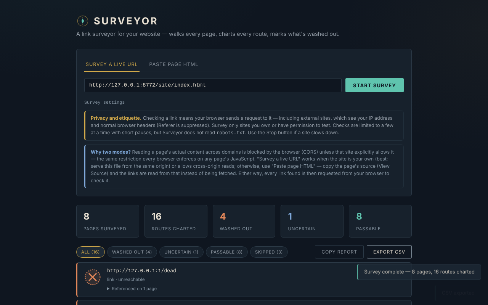

# Surveyor

**Versiune:** 1.1.0 · **Ultima actualizare:** 14 octombrie 2026

Verificator de linkuri pentru site-uri, într-un singur fișier HTML. Interfața este în **engleză**; documentația (acest fișier) este în română.

**Live:** https://chiuta.github.io/Surveyor/

## Ce este

Surveyor ia o pagină de start, citește linkurile `<a href>` (și, opțional, imaginile ``), parcurge paginile de pe aceeași origine și verifică dacă fiecare adresă răspunde. Rezultatele pot fi filtrate, copiate ca raport text sau exportate CSV. Nu are server, analytics, cookie-uri și nu salvează nimic între vizite.

**Important:** nu este un instrument „local-only”. Pentru a verifica un link, browserul tău trimite o cerere către acel link, inclusiv către site-uri externe (vezi „Confidențialitate și rețea”).

## Funcții

Verificate în cod și într-un browser headless (Chromium/Playwright) pe un site de test local:

- Două moduri: **Survey a live URL** (descarcă pagina de start și paginile de pe aceeași origine) și **Paste page HTML** (citește linkurile din HTML-ul lipit, cu URL de bază opțional pentru linkurile relative; respectă `<base href>`).
- Setări: număr maxim de pagini (1–200, implicit 25), adâncime (1–10, implicit 3), verificarea imaginilor. Doar paginile de aceeași origine sunt parcurse; linkurile externe sunt doar verificate, niciodată parcurse.
- Patru stări: **Passable**, **Washed out**, **Uncertain**, **Skipped** (vezi „Limite”). Filtre pe stare, listă cu paginile care conțin fiecare link.
- Cerere cu timeout (9 s pentru verificări, 15 s pentru o pagină); la 400/403/405/501 la `HEAD` se reîncearcă cu `GET`.
- Buton **Stop**: oprește toate cererile în curs; ce nu a fost verificat apare ca „skipped / stopped”.
- Limite: cel mult 4 verificări în paralel, cu pauză de 250 ms între loturi; maximum 3000 de adrese distincte per rulare; se afișează primele 500 de rânduri (CSV conține tot).
- **Copy report** (text) și **Export CSV**. În CSV, celulele care încep cu `=`, `+`, `-`, `@`, TAB sau CR sunt prefixate cu apostrof (previne execuția de formule în Excel/Calc); fișierul are BOM UTF-8.
- Linkurile `javascript:`, `data:`, `mailto:` etc. apar ca text, nu ca linkuri pe care se poate da click.
- Ancore în pagină (`#sectiune`) verificate local față de `id`/`name` din HTML-ul citit sau lipit — singurul tip de „link rupt” detectabil fiabil și în modul Paste / `file://`.
- Temă luminoasă la cerere (preferința sistemului) și stil de tipărire.
- Accesibilitate: tab-uri cu săgeți/Home/End, `aria-selected`, bară de progres cu `role="progressbar"`, focus vizibil.

## Manual de utilizare

1. Deschide pagina (sau `index.html` local).
2. **Survey a live URL**: introdu adresa `http(s)://…` a site-ului tău și apasă **Start survey**. Cel mai fiabil e ca Surveyor să fie servit de pe **aceeași origine** cu site-ul verificat; altfel site-ul trebuie să trimită anteturi CORS (`Access-Control-Allow-Origin`), inclusiv pe răspunsurile de eroare. Dacă pagina de start nu se poate citi, vei vedea un mesaj.
3. **Paste page HTML**: lipește sursa paginii (View Source), completează opțional URL-ul de bază și apasă **Check these links**.
4. Urmărește progresul; **Stop** întrerupe rularea.
5. Filtrează după stare și deschide „Referenced on N pages” pentru a vedea unde trebuie corectat linkul.
6. **Copy report** copiază un rezumat al linkurilor „washed out”; **Export CSV** descarcă toate rezultatele.

## Confidențialitate și rețea

- **Stocare:** niciuna. Nu folosește `localStorage`, `sessionStorage`, IndexedDB sau cookie-uri.
- **Gazde externe încărcate de pagină:** niciuna (fără CDN, fonturi sau scripturi externe). Politica CSP din `<meta>` permite scriptul doar pe bază de hash și conexiuni `http(s)`.
- **Ce trimite totuși:** pentru fiecare adresă verificată, browserul tău trimite o cerere `HEAD` (uneori `GET`) către gazda acelei adrese. Asta include **site-urile externe**: ele văd adresa ta IP și anteturile obișnuite ale browserului (User-Agent). Cererile sunt făcute cu `referrerPolicy: no-referrer` (fără antet Referer) și, către terți, fără cookie-uri. Cererile către site-ul verificat pot include antetul `Origin` cu originea paginii unde e găzduit Surveyor. În modul „live URL” se descarcă integral paginile parcurse.
- **Ce NU se întâmplă:** niciun apel către autor sau către un server al aplicației; rapoartele (Copy/CSV) rămân în browserul tău până le salvezi sau le lipești tu.
- **HTML primit de la terți:** paginile descărcate sau lipite sunt parsate cu `DOMParser` (document inert: fără scripturi executate, fără subresurse încărcate). Adresele afișate în rezultate sunt escapate, iar doar cele `http(s)` devin linkuri (`rel="noopener noreferrer"`).

### Etică și politețe

Verifică doar site-uri ale tale sau pentru care ai permisiune. Surveyor **nu citește `robots.txt`** și nu limitează cererile pe gazdă dincolo de cei 4 paraleli cu pauze; nu e conceput pentru a parcurge site-uri terțe. Oprește rularea dacă un server încetinește. Respectă termenii site-urilor verificate.

## Limite și avertismente

- **Linkurile externe nu pot fi confirmate.** Browserul ascunde statusul HTTP al răspunsurilor cross-origin (CORS): un link extern care răspunde, chiar cu 404, apare ca **Uncertain**. Surveyor găsește doar gazde de neatins (DNS, conexiune refuzată, timeout), nu pagini moarte pe site-uri străine. Poate fi tentant să citești „Passable” = bun; pentru externe acea stare nu apare niciodată.
- **„Washed out” pe linkuri externe poate fi fals alarmă:** extensii/ad-blockere, VPN, firewall, mixed content (verificarea unui site `http://` dintr-o pagină `https://`) arată la fel ca „unreachable”. Reverifică înainte să modifici pagini.
- Dacă citirea cu CORS e blocată pentru un link de pe origine „internă”, rezultatul coboară la „Uncertain” (nu „Washed out”) atunci când gazda totuși răspunde.
- Citește doar HTML static: linkurile generate de JavaScript (SPA), `srcset`, `<link>`, scripturi, stilurile CSS, iframe-urile și atributele `data-src` nu sunt văzute. `www.exemplu.ro` și `exemplu.ro` sunt origini diferite (al doilea e tratat ca extern).
- Pagini mai mari de 5 MB (după `Content-Length`) nu sunt parcurse; limite: 200 de pagini, 3000 de adrese.
- Rezultatele sunt un instantaneu; un site care răspunde lent sau cu limitare de rată poate genera „timed out”.
- Proiect personal, oferit „ca atare”, fără garanții.

## Rulare locală / offline

Descarcă `index.html` și deschide-l în browser. Pagina pornește fără internet, dar verificarea linkurilor cere rețea. De pe `file://` modul „live URL” funcționează doar cu site-uri care permit CORS.

## Licență

MIT — vezi fișierul `LICENSE`. Declarată în antetul fișierului `index.html` și în subsolul paginii.

## Istoric / Changelog

- 1.1.0 — 2026-10-14: Copie de rezervă și etichetare date (fff-kit).

- 1.0.0 — 2026-10-12: versiunea și data ultimei actualizări sunt afișate în aplicație (prima versiune numerotată).

Runda 7:
- **Corectat contorul „Pages surveyed”:** număra fiecare cerere de pagină (inclusiv 404, redirecționări și alias-uri precum `/b` → `/b/`); acum numără doar paginile citite efectiv, o singură dată după URL-ul final (pe un site de test cu 3 pagini, 1 link rupt și 2 redirecționări, afișa 6; acum 3). Limita „max pages” rămâne pe numărul de cereri.
- **Notă explicativă când rezultatele sunt „unreadable”:** dacă Surveyor e deschis din `file://` (sau linkuri de pe aceeași origine nu pot fi citite din cauza CORS), sub sumar apare o notă care spune că acele linkuri sunt „Uncertain”, nu rupte, și cum se obțin statusuri reale (servire de pe site-ul verificat / `http://localhost`).
- **Redirecționări vizibile:** linkurile care răspund după o redirecționare arată „HTTP 200 · redirects to …” (și în CSV / Copy report).
- Hash-ul CSP al scriptului a fost recalculat. axe-core: 0 violări la 1280 și 360 px.
- **Ancore în pagină verificate:** linkurile `#sectiune` sunt comparate cu `id`/`name` din pagina citită (modul Paste și live); o ancoră lipsă apare ca „Washed out”, tip „anchor”. `#` și `#top` sunt mereu valide; în modul live se verifică și `alta-pagina#parte` dacă pagina respectivă a fost citită. Ancorele generate de JavaScript nu sunt văzute. Linkurile `#…` fără URL de bază nu mai apar ca „unparseable”.
- Temă luminoasă automată (`prefers-color-scheme: light`; implicit rămâne cea întunecată) și stil de tipărire (se tipărește doar lista de rezultate).
- Hash-ul CSP al scriptului a fost recalculat. axe-core: 0 violări la 1280 și 360 px, în ambele teme.

Runda 5:
- Linkurile doar-fragment (`#top`, `pagina#sectiune` către aceeași pagină) nu mai sunt numărate ca rute (iar în runda 6 sunt verificate ca ancore); variantele cu fragment diferit ale aceluiași URL se unesc într-o singură rută.
- Linkurile de pe aceeași origine ca site-ul verificat, dar ale căror răspunsuri nu pot fi citite din pagina curentă (modul Paste sau `file://`, fără CORS), apar acum ca „Uncertain — same site, status unreadable from this page (CORS/file://)”, nu ca „cross-origin”. Limita rămâne: un 404 nu poate fi detectat fără CORS sau fără servirea Surveyor de pe aceeași origine.
- Hash-ul CSP al scriptului a fost recalculat. axe-core: 0 violări la 1280 și 360 px.

## Autor

Alexio — Alexandru-Ionuț Chiuță, contact: alexio@trom.tf

## English summary

Surveyor is a single-file link checker (English UI): it reads a page, follows same-origin links, and checks links and images, with Stop, a politeness cap (4 parallel checks, 250 ms pauses, 3000 URLs) and CSV/text reports (CSV formula injection neutralised). It stores nothing and has no analytics, but it is not local-only: your browser sends HEAD/GET requests to every site it checks, including external ones (IP visible, no Referer). Because of CORS, external links can only be "uncertain" or "unreachable"; a 404 on another site is not detected. It does not read robots.txt: survey only sites you own or have permission to test. MIT licence.
