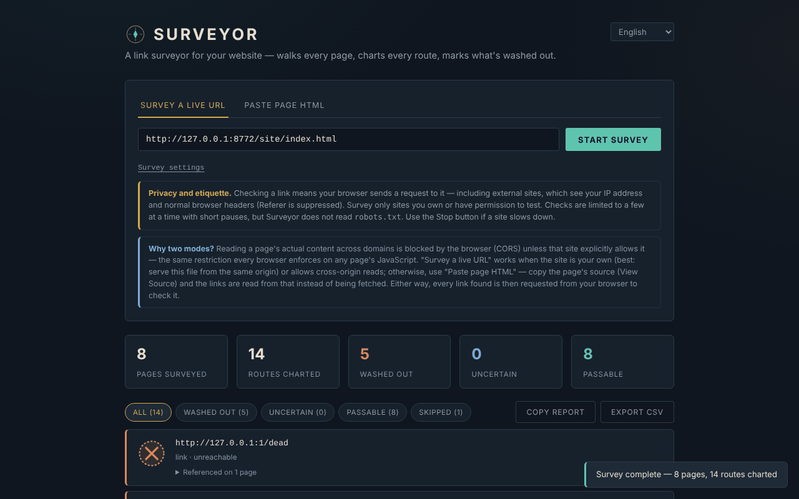

# Surveyor

**English** · [Română](README.ro.md) · [Français](README.fr.md) · [Italiano](README.it.md) · [Español](README.es.md) · [Português](README.pt.md) · [Deutsch](README.de.md) · [Magyar](README.hu.md)

**Version:** 2.1.0 · **Last updated:** 2026-10-27

**Status:** stable. **Offline:** no — checking links needs internet and contacts the hosts from your browser (see “Privacy and network”); the UI, exports and the companion script work without any server of ours.

Interface languages: **Română, English, Français, Italiano, Español, Português (PT), Deutsch, Magyar**

A link checker for websites, in a single HTML file. The interface has **8 languages** (RO, EN, FR, IT, ES, PT, DE, HU); the documentation (this file) is in English.

**Live:** https://chiuta.github.io/Surveyor/



## What it is

Surveyor takes a start page, reads the `<a href>` links (and, optionally, the `` images), crawls the pages on the same origin and checks whether each address responds. The results can be filtered, copied as a text report or exported as CSV. It has no server, no analytics, no cookies, and saves nothing between visits.

**Important:** it is not a "local-only" tool. To check a link, your browser sends a request to that link, including to external sites (see "Privacy and network").

## Features

Verified in the code and in a headless browser (Chromium/Playwright) on a local test site:

- Two modes: **Survey a live URL** (downloads the start page and the pages on the same origin) and **Paste page HTML** (reads the links from the pasted HTML, with an optional base URL for relative links; honours `<base href>`).
- Settings: maximum number of pages (1–200, default 25), depth (1–10, default 3), image checking. Only same-origin pages are crawled; external links are only checked, never crawled.
- Four states: **Passable**, **Washed out**, **Uncertain**, **Skipped** (see "Limits"). Filters by state, a list of the pages that contain each link.
- Requests with a timeout (9 s for checks, 15 s for a page); on 400/403/405/501 to `HEAD` it retries with `GET`.
- **Stop** button: aborts all requests in progress; whatever was not checked appears as "skipped / stopped".
- Limits: at most 4 parallel checks, with a 250 ms pause between batches; at most 3000 distinct addresses per run; the first 500 rows are displayed (the CSV contains everything).
- **Copy report** (text) and **Export CSV**. In the CSV, cells that start with `=`, `+`, `-`, `@`, TAB or CR are prefixed with an apostrophe (this prevents formula execution in Excel/Calc); the file has a UTF-8 BOM.
- `javascript:`, `data:`, `mailto:` etc. links appear as text, not as clickable links.
- In-page anchors (`#section`) are checked locally against the `id`/`name` attributes in the HTML that was read or pasted — the only type of "broken link" that can be detected reliably in Paste mode / `file://` as well.
- Light theme on request (system preference) and a print style.
- Accessibility: tabs with arrows/Home/End, `aria-selected`, a progress bar with `role="progressbar"`, visible focus.
- **Site map (2.0.0):** after a survey, an interactive graph of internal links shows click depth from the start page; two scans can be compared (previous run, or a scan saved as JSON): pages and links that appeared or disappeared, changed statuses. Nothing is kept between visits unless you save the file.
- **Orphan pages, hreflang, link text, Sitemap XML:** optionally reads `sitemap.xml` (one extra request, off by default) to find pages nothing links to; checks hreflang (code, self-reference, return link) and empty or generic link text; exports a Sitemap XML from the pages read (no invented data).

## User guide

1. Open the page (or `index.html` locally).
2. **Survey a live URL**: enter the `http(s)://…` address of your site and press **Start survey**. It is most reliable when Surveyor is served from the **same origin** as the site being checked; otherwise the site must send CORS headers (`Access-Control-Allow-Origin`), including on error responses. If the start page cannot be read, you will see a message.
3. **Paste page HTML**: paste the page source (View Source), optionally fill in the base URL and press **Check these links**.
4. Follow the progress; **Stop** interrupts the run.
5. Filter by state and open "Referenced on N pages" to see where the link must be corrected.
6. **Copy report** copies a summary of the "washed out" links; **Export CSV** downloads all the results.

## Companion for external links (2.1.0)

The browser cannot read the status of external links (CORS), so Surveyor marks them **Uncertain**. The button **Export external links (.txt)** writes those addresses one per line; the optional script [`companion/surveyor-companion.mjs`](companion/surveyor-companion.mjs) (Node 18+, **no dependencies**, no telemetry, MIT) then checks them from your machine, where CORS does not apply:

```
node companion/surveyor-companion.mjs surveyor-external-links-2026-10-27.txt --only-problems
node companion/surveyor-companion.mjs surveyor-report.csv --format json --out result.json   # it also reads Surveyor's CSV
```

It reports `ok`, `moved` (permanent redirect), `uncertain` (401/403/429: often bot blocking, check by hand) and `broken` (404/410/5xx/DNS/timeout), identifies itself honestly in the User-Agent, pauses between requests to the same host and does not read `robots.txt`: use it only for sites of your own or with the owner's consent. **Status: experimental; tested only against local test servers, not against real third-party sites.** It is not [Trade-Free-Link-Guardian](https://github.com/chiuta/Trade-Free-Link-Guardian): that one is a WordPress plugin that watches the links of your WordPress site on a schedule; Surveyor checks any site on demand, and the companion only completes the external links.

Interface languages: Romanian is a complete, selectable language (and the default when the browser reports `ro`). The text of **Copy report** is still English only (planned).

## Privacy and network

- **Storage:** none. It does not use `localStorage`, `sessionStorage`, IndexedDB or cookies.
- **External hosts loaded by the page:** none (no CDN, fonts or external scripts). The CSP in the `<meta>` allows the script only by hash and `http(s)` connections.
- **What it does send:** for each address checked, your browser sends a `HEAD` request (sometimes `GET`) to that address's host. This includes **external sites**: they see your IP address and the usual browser headers (User-Agent). The requests are made with `referrerPolicy: no-referrer` (no Referer header) and, to third parties, without cookies. Requests to the site being checked may include the `Origin` header with the origin of the page where Surveyor is hosted. In "live URL" mode the crawled pages are downloaded in full.
- **What does NOT happen:** no call to the author or to an application server; the reports (Copy/CSV) stay in your browser until you save or paste them yourself.
- **HTML received from third parties:** downloaded or pasted pages are parsed with `DOMParser` (an inert document: no scripts executed, no subresources loaded). The addresses shown in the results are escaped, and only the `http(s)` ones become links (`rel="noopener noreferrer"`).

### Ethics and courtesy

Check only sites of your own or ones you have permission for. Surveyor **does not read `robots.txt`** and does not limit requests per host beyond the 4 parallel ones with pauses; it is not designed to crawl third-party sites. Stop the run if a server slows down. Respect the terms of the sites you check.

## Limits and warnings

- **External links cannot be confirmed.** The browser hides the HTTP status of cross-origin responses (CORS): an external link that responds, even with a 404, appears as **Uncertain**. Surveyor only finds unreachable hosts (DNS, connection refused, timeout), not dead pages on foreign sites. It may be tempting to read "Passable" = good; for external links that state never appears.
- **"Washed out" on external links can be a false alarm:** extensions/ad blockers, VPN, firewall, mixed content (checking an `http://` site from an `https://` page) look the same as "unreachable". Re-check before you modify pages.
- If CORS reading is blocked for a link on an "internal" origin, the result drops to "Uncertain" (not "Washed out") when the host does respond.
- It reads only static HTML: JavaScript-generated links (SPA), `srcset`, `<link>`, scripts, CSS styles, iframes and `data-src` attributes are not seen. `www.example.com` and `example.com` are different origins (the second is treated as external).
- Pages larger than 5 MB (by `Content-Length`) are not crawled; limits: 200 pages, 3000 addresses.
- The results are a snapshot; a site that responds slowly or with rate limiting can produce "timed out".
- A personal project, offered "as is", without warranties.

## Running locally / offline

Download `index.html` and open it in the browser. The page starts without internet, but link checking requires a network. From `file://` the "live URL" mode works only with sites that allow CORS.

## Licence

MIT — see the `LICENSE` file. Declared in the header of the `index.html` file and in the page footer.

## History / Changelog

### 2.1.0 — 2026-10-27
- “Export external links” button, `companion/surveyor-companion.mjs`, status/offline lines, `CHANGELOG.md`. Previously: v2.0.0.

### 1.2.4 — 2026-10-22

fff-kit 1.1.4: touch targets and minimum text size.

### 1.2.3 — 2026-10-22
- fff-kit 1.1.2: PBKDF2 600,000 iterations, anti-clickjacking protection

### 1.2.2 — 2026-10-22
- Mobile: no text below 12 px and touch targets of at least 24 px (WCAG 2.5.8).

### 1.2.1 — 2026-10-22
- Translation fixes: the page title and meta tags now follow the interface language; leftover texts in the wrong language removed.

- 1.1.0 — 2026-10-14: Backup and data labelling (fff-kit).

- 1.0.0 — 2026-10-12: the version and the last-updated date are shown in the application (first numbered version).

Round 7:
- **Fixed the "Pages surveyed" counter:** it counted every page request (including 404s, redirects and aliases such as `/b` → `/b/`); it now counts only pages actually read, once per final URL (on a test site with 3 pages, 1 broken link and 2 redirects, it showed 6; now 3). The "max pages" limit remains on the number of requests.
- **Explanatory note when results are "unreadable":** if Surveyor is opened from `file://` (or same-origin links cannot be read because of CORS), a note appears under the summary saying that those links are "Uncertain", not broken, and how to obtain real statuses (serving it from the site being checked / `http://localhost`).
- **Visible redirects:** links that respond after a redirect show "HTTP 200 · redirects to …" (also in the CSV / Copy report).
- The CSP hash of the script was recalculated. axe-core: 0 violations at 1280 and 360 px.
- **In-page anchors checked:** `#section` links are compared with the `id`/`name` attributes in the page that was read (Paste and live modes); a missing anchor appears as "Washed out", type "anchor". `#` and `#top` are always valid; in live mode `other-page#part` is also checked if that page was read. JavaScript-generated anchors are not seen. `#…` links without a base URL no longer appear as "unparseable".
- Automatic light theme (`prefers-color-scheme: light`; the dark one remains the default) and a print style (only the results list is printed).
- The CSP hash of the script was recalculated. axe-core: 0 violations at 1280 and 360 px, in both themes.

Round 5:
- Fragment-only links (`#top`, `page#section` to the same page) are no longer counted as routes (and in round 6 they are checked as anchors); variants of the same URL with a different fragment are merged into a single route.
- Links on the same origin as the site being checked but whose responses cannot be read from the current page (Paste mode or `file://`, without CORS) now appear as "Uncertain — same site, status unreadable from this page (CORS/file://)", not as "cross-origin". The limit remains: a 404 cannot be detected without CORS or without serving Surveyor from the same origin.
- The CSP hash of the script was recalculated. axe-core: 0 violations at 1280 and 360 px.

## Author

Alexio — Alexandru-Ionuț Chiuță, contact: alexio@trom.tf
