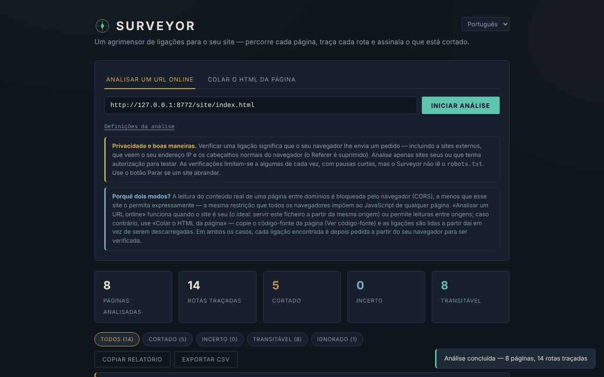

# Surveyor

[English](README.md) · [Română](README.ro.md) · [Français](README.fr.md) · [Italiano](README.it.md) · [Español](README.es.md) · **Português** · [Deutsch](README.de.md) · [Magyar](README.hu.md)

**Versão:** 1.2.1 · **Última atualização:** 2026-10-22

Idiomas da interface: **Română, English, Français, Italiano, Español, Português (PT), Deutsch, Magyar**

Verificador de ligações para sítios web, num único ficheiro HTML. A interface tem **8 idiomas** (RO, EN, FR, IT, ES, PT, DE, HU); a documentação (este ficheiro) está em português.

**Online:** https://chiuta.github.io/Surveyor/

## O que é

O Surveyor recebe uma página inicial, lê as ligações `<a href>` (e, opcionalmente, as imagens ``), percorre as páginas da mesma origem e verifica se cada endereço responde. Os resultados podem ser filtrados, copiados como relatório de texto ou exportados em CSV. Não tem servidor, analítica nem cookies, e não guarda nada entre visitas.

**Importante:** não é uma ferramenta «apenas local». Para verificar uma ligação, o seu navegador envia um pedido para essa ligação, incluindo para sítios externos (ver «Privacidade e rede»).

## Funcionalidades

Verificadas no código e num navegador headless (Chromium/Playwright) num sítio de teste local:

- Dois modos: **Survey a live URL** (descarrega a página inicial e as páginas da mesma origem) e **Paste page HTML** (lê as ligações do HTML colado, com um URL de base opcional para as ligações relativas; respeita `<base href>`).
- Definições: número máximo de páginas (1–200, predefinição 25), profundidade (1–10, predefinição 3), verificação de imagens. Apenas as páginas da mesma origem são percorridas; as ligações externas são só verificadas, nunca percorridas.
- Quatro estados: **Passable**, **Washed out**, **Uncertain**, **Skipped** (ver «Limites»). Filtros por estado, lista das páginas que contêm cada ligação.
- Pedidos com tempo limite (9 s para as verificações, 15 s para uma página); em caso de 400/403/405/501 em `HEAD`, repete-se com `GET`.
- Botão **Stop**: interrompe todos os pedidos em curso; o que não foi verificado surge como «skipped / stopped».
- Limites: no máximo 4 verificações em paralelo, com uma pausa de 250 ms entre lotes; no máximo 3000 endereços distintos por execução; são apresentadas as primeiras 500 linhas (o CSV contém tudo).
- **Copy report** (texto) e **Export CSV**. No CSV, as células que começam por `=`, `+`, `-`, `@`, TAB ou CR levam um apóstrofo como prefixo (impede a execução de fórmulas no Excel/Calc); o ficheiro tem BOM UTF-8.
- As ligações `javascript:`, `data:`, `mailto:`, etc. surgem como texto, não como ligações clicáveis.
- As âncoras dentro da página (`#secao`) são verificadas localmente face aos atributos `id`/`name` do HTML lido ou colado — o único tipo de «ligação quebrada» detetável de forma fiável também no modo Paste / `file://`.
- Tema claro a pedido (preferência do sistema) e estilo de impressão.
- Acessibilidade: separadores com setas/Home/End, `aria-selected`, barra de progresso com `role="progressbar"`, foco visível.

## Manual de utilização

1. Abra a página (ou `index.html` localmente).
2. **Survey a live URL**: introduza o endereço `http(s)://…` do seu sítio e prima **Start survey**. É mais fiável quando o Surveyor é servido a partir da **mesma origem** que o sítio verificado; caso contrário, o sítio tem de enviar cabeçalhos CORS (`Access-Control-Allow-Origin`), incluindo nas respostas de erro. Se a página inicial não puder ser lida, verá uma mensagem.
3. **Paste page HTML**: cole o código-fonte da página (Ver código-fonte), preencha opcionalmente o URL de base e prima **Check these links**.
4. Acompanhe o progresso; **Stop** interrompe a execução.
5. Filtre por estado e abra «Referenced on N pages» para ver onde a ligação deve ser corrigida.
6. **Copy report** copia um resumo das ligações «washed out»; **Export CSV** descarrega todos os resultados.

## Privacidade e rede

- **Armazenamento:** nenhum. Não utiliza `localStorage`, `sessionStorage`, IndexedDB nem cookies.
- **Anfitriões externos carregados pela página:** nenhum (sem CDN, tipos de letra ou scripts externos). A política CSP da etiqueta `<meta>` permite o script apenas por hash e as ligações `http(s)`.
- **O que envia, ainda assim:** para cada endereço verificado, o seu navegador envia um pedido `HEAD` (por vezes `GET`) ao anfitrião desse endereço. Isto inclui os **sítios externos**: veem o seu endereço IP e os cabeçalhos habituais do navegador (User-Agent). Os pedidos são feitos com `referrerPolicy: no-referrer` (sem cabeçalho Referer) e, para terceiros, sem cookies. Os pedidos ao sítio verificado podem incluir o cabeçalho `Origin` com a origem da página onde o Surveyor está alojado. No modo «live URL» as páginas percorridas são descarregadas na íntegra.
- **O que NÃO acontece:** nenhuma chamada ao autor ou a um servidor da aplicação; os relatórios (Copy/CSV) permanecem no seu navegador até os guardar ou colar você mesmo.
- **HTML recebido de terceiros:** as páginas descarregadas ou coladas são analisadas com `DOMParser` (documento inerte: nenhum script executado, nenhum subrecurso carregado). Os endereços apresentados nos resultados são escapados, e apenas os `http(s)` passam a ligações (`rel="noopener noreferrer"`).

### Ética e cortesia

Verifique apenas sítios seus ou para os quais tenha autorização. O Surveyor **não lê `robots.txt`** e não limita os pedidos por anfitrião para além dos 4 paralelos com pausas; não foi concebido para percorrer sítios de terceiros. Interrompa a execução se um servidor abrandar. Respeite os termos dos sítios verificados.

## Limites e avisos

- **As ligações externas não podem ser confirmadas.** O navegador oculta o estado HTTP das respostas cross-origin (CORS): uma ligação externa que responde, mesmo com um 404, surge como **Uncertain**. O Surveyor só encontra anfitriões inacessíveis (DNS, ligação recusada, tempo limite), não páginas mortas em sítios alheios. Pode ser tentador ler «Passable» = bom; para as externas esse estado nunca aparece.
- **«Washed out» em ligações externas pode ser um falso alarme:** extensões/bloqueadores de anúncios, VPN, firewall, conteúdo misto (verificação de um sítio `http://` a partir de uma página `https://`) têm o mesmo aspeto que «unreachable». Volte a verificar antes de alterar páginas.
- Se a leitura CORS estiver bloqueada para uma ligação de origem «interna», o resultado desce para «Uncertain» (e não «Washed out») quando o anfitrião, ainda assim, responde.
- Lê apenas HTML estático: as ligações geradas por JavaScript (SPA), `srcset`, `<link>`, os scripts, os estilos CSS, as iframes e os atributos `data-src` não são vistos. `www.exemplo.pt` e `exemplo.pt` são origens diferentes (a segunda é tratada como externa).
- As páginas com mais de 5 MB (segundo `Content-Length`) não são percorridas; limites: 200 páginas, 3000 endereços.
- Os resultados são um instantâneo; um sítio que responde lentamente ou com limitação de taxa pode gerar «timed out».
- Projeto pessoal, oferecido «tal como está», sem garantias.

## Execução local / offline

Descarregue `index.html` e abra-o no navegador. A página arranca sem internet, mas a verificação das ligações exige rede. A partir de `file://` o modo «live URL» só funciona com sítios que permitam CORS.

## Licença

MIT — ver o ficheiro `LICENSE`. Declarada no cabeçalho do ficheiro `index.html` e no rodapé da página.

## Histórico / Changelog

### 1.2.1 — 2026-10-22
- Correções de tradução: o título da página e as metaetiquetas seguem o idioma da interface; removidos os textos que ficavam no idioma errado.

- 1.1.0 — 2026-10-14: cópia de segurança e etiquetagem de dados (fff-kit).

- 1.0.0 — 2026-10-12: a versão e a data da última atualização são apresentadas na aplicação (primeira versão numerada).

Ronda 7:
- **Corrigido o contador «Pages surveyed»:** contava cada pedido de página (incluindo 404, redirecionamentos e aliases como `/b` → `/b/`); agora conta apenas as páginas efetivamente lidas, uma única vez por URL final (num sítio de teste com 3 páginas, 1 ligação quebrada e 2 redirecionamentos, mostrava 6; agora 3). O limite «max pages» continua a aplicar-se ao número de pedidos.
- **Nota explicativa quando os resultados são «unreadable»:** se o Surveyor for aberto a partir de `file://` (ou as ligações da mesma origem não puderem ser lidas por causa do CORS), por baixo do resumo surge uma nota a dizer que essas ligações são «Uncertain», não quebradas, e como obter estados reais (servi-lo a partir do sítio verificado / `http://localhost`).
- **Redirecionamentos visíveis:** as ligações que respondem após um redirecionamento mostram «HTTP 200 · redirects to …» (também no CSV / Copy report).
- O hash CSP do script foi recalculado. axe-core: 0 violações a 1280 e 360 px.
- **Âncoras dentro da página verificadas:** as ligações `#secao` são comparadas com os atributos `id`/`name` da página lida (modos Paste e live); uma âncora em falta surge como «Washed out», do tipo «anchor». `#` e `#top` são sempre válidos; no modo live verifica-se também `outra-pagina#parte` se essa página tiver sido lida. As âncoras geradas por JavaScript não são vistas. As ligações `#…` sem URL de base deixam de surgir como «unparseable».
- Tema claro automático (`prefers-color-scheme: light`; o escuro continua a ser o predefinido) e estilo de impressão (imprime-se apenas a lista de resultados).
- O hash CSP do script foi recalculado. axe-core: 0 violações a 1280 e 360 px, em ambos os temas.

Ronda 5:
- As ligações só com fragmento (`#top`, `pagina#secao` para a mesma página) deixam de ser contadas como rotas (e na ronda 6 são verificadas como âncoras); as variantes do mesmo URL com fragmento diferente são fundidas numa única rota.
- As ligações da mesma origem do sítio verificado, mas cujas respostas não podem ser lidas a partir da página atual (modo Paste ou `file://`, sem CORS), surgem agora como «Uncertain — same site, status unreadable from this page (CORS/file://)», e não como «cross-origin». O limite mantém-se: um 404 não pode ser detetado sem CORS ou sem servir o Surveyor a partir da mesma origem.
- O hash CSP do script foi recalculado. axe-core: 0 violações a 1280 e 360 px.

## Autor

Alexio — Alexandru-Ionuț Chiuță, contacto: alexio@trom.tf
